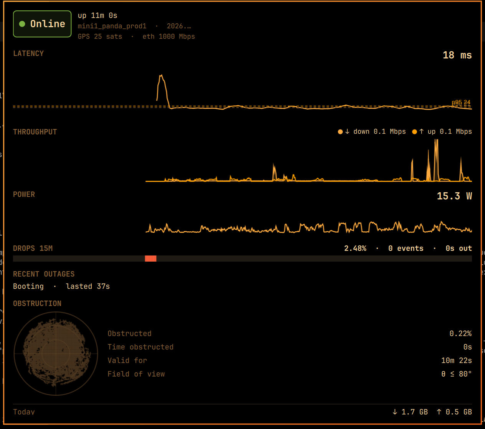

# Dishy

Starlink status for the [Omarchy](https://omarchy.org) shell: a bar widget with
your live latency (or throughput), a colored health dot, and a rich dashboard
popup — latency/throughput/power graphs, outage log, obstruction view, data
usage, availability, dish alerts, and stow/unstow/reboot controls.



```
omarchy plugin add https://github.com/nulluserid/omarchy-dishy.git --enable
```

Then run `./install.sh` once (from this directory) to install the `starlinkd`
backend service. The bar widget shows live data within ~2 seconds.

## What it shows

- **Bar:** satellite glyph + health dot (green online / amber searching or
  attention / red offline / gray no data) and live latency, down throughput,
  typical active throughput, or icon only (click the widget's settings).
  Amber covers every attention-worthy dish alert (stuck motors, water,
  slow ethernet, … — heating and power-save stay green), a pending
  update reboot, and any disablement code; the tooltip lists all active
  alerts plus the software-update state, so nothing the dish reports is
  easy to miss.
- **Auto-hide off-network (1.1):** when the machine is not on a Starlink
  network, the widget hides itself — the dish's exact gRPC target no longer
  answers *as a Starlink dish*, and your traffic provably exits through
  another carrier — while `starlinkd` keeps checking in the
  background (10 s ticks). Back on Starlink, the widget reappears by itself;
  no shell restart, no service restart. During connection drops, captive
  portals, or missing evidence the widget keeps showing for 10 minutes
  (grace) first. Turn it off with the widget's *Hide when not on Starlink*
  setting.
- **Bar placement (1.4):** Dishy sits in any bar section and moves like any
  Omarchy widget — `omarchy bar move io.github.nulluserid.dishy --section
  center` (or `right` / `left`); the dashboard follows the button.
- **Panel** (click the widget; dense single-view grid, no scrolling):
  - state chip, dish uptime + short id, hardware/software versions, GPS +
    ethernet link
  - latency graph (15 min, 1 s resolution, p50/p95 guides) beside
    throughput (down fill / up line, typical-active readout) — drop strip
    and 15-min drop stats under the latency plot
  - Today chart (per-minute typical active throughput, 30-day rolling
    history in `~/.local/state/starlinkd/dishes/<dish-id>/day-YYYYMMDD.json`)
    beside power draw
  - recent outages with cause and duration (dish-reported, latest three)
  - obstruction view (sky-coverage map + stats) beside the egress lookup:
    public IP + approximate exit city/region and carrier — one ifconfig.co
    query every few minutes, no API key
  - one-line usage grid: today / all-time / availability
  - active dish alert chips + software-update state
  - Stow / Unstow / Reboot — each behind an explicit click-to-confirm
- **Multiple dishes (1.3):** stats are per dish. Move the machine between
  Starlinks (or change the dish address) and each dish keeps its own usage,
  availability, and day history in
  `~/.local/state/starlinkd/dishes/<dish-id>/` — alternating between a
  couple of dishes in a week never blends their numbers. A dish you have
  not used before simply starts at zero. Housekeeping (1.5): a partition
  with no connection for 30 days is deleted whole at the next startup or
  day roll, and every partition rolls its day files through the same
  30-day retention as the active one. Old ≤ v1.2 top-level
  `daily.json`/`day-*.json` files are legacy (and may mix dishes); they
  share the 30-day retention and are safe to delete.
- **Notifications:** desktop notification when an outage starts and ends, when
  a dish alert sets, and on sustained heavy obstruction. Notifications fire on
  transitions; a dish that is already unreachable when the daemon starts stays
  quiet on purpose — and (1.1) they never fire for a machine parked on another
  network: off-network time is not counted as dish downtime.

## Requirements

- A Starlink dish reachable at `192.168.100.1` (default; any router setup that
  lets the Starlink app work also lets Dishy work)
- Omarchy's shell (Quickshell) — this is a `bar-widget` plugin
- `systemd` user session for the backend service
- `notify-send` for notifications (optional; already part of Omarchy)

`backend/bin/starlinkd` is a committed static Go binary (no runtime
dependencies, deterministically built with `CGO_ENABLED=0 -trimpath
-buildvcs=false` and version-stamped to the release tag — verify with
`go version -m backend/bin/starlinkd` and `backend/bin/starlinkd -version`).
To rebuild it yourself at a tag: `backend/build.sh` needs `go` (≥ 1.27, matching backend/go.mod)
and `protoc`; the protobuf descriptors are captured from the dish itself via
gRPC reflection (`backend/proto/dish.pb`) — nothing hand-maintained.

## Install

1. `omarchy plugin add https://github.com/nulluserid/omarchy-dishy.git --enable`
2. From the plugin directory: `./install.sh`
   (installs + enables the `starlinkd` systemd user service)

Optional keybind — toggle the panel with `omarchy-shell dishy toggle`.

The dish address is a widget setting (default `192.168.100.1:9200`; changing
it is pushed to `starlinkd` live, no restart). There is deliberately no DNS
fallback: on a VPN or foreign network, a hostname must not silently redirect
dish traffic.

Upgrading from ≤ 1.1.1: run `./install.sh` once — the service unit no longer
pins the dish target, which is what makes the setting (and `starlinkd set
host`) effective.

## Remove

```bash
systemctl --user disable --now starlinkd.service
rm ~/.config/systemd/user/starlinkd.service
systemctl --user daemon-reload
omarchy plugin remove io.github.nulluserid.dishy   # or delete the plugin directory
rm -rf ~/.local/state/starlinkd                   # optional: usage/outage history
```

## Marketplace

Dishy's Omarchy plugin marketplace entry: [`io.github.nulluserid.dishy`](https://plugins.omarchy.org).
A listing is pinned to a validated commit — not a tag: once listed, changes to this repo
reach users via the marketplace's
[verification flow](https://github.com/omacom/omarchy-plugin-marketplace/blob/main/VERIFICATION.md).
Keep `main` shippable and tag releases as usual. The full release + deploy +
marketplace-update pipeline lives in [RELEASING.md](RELEASING.md).

## How it works

Two small pieces with one tiny file contract:

```
starlinkd (Go daemon, one static binary)          Dishy plugin (QML)
  gRPC 192.168.100.1:9200 — GetStatus +            bar widget + dashboard,
  GetHistory cursor-delta over the dish's          reads the state files,
  900-sample ring, derives stats once,             never talks to the dish
  writes atomic JSON  ──────────────────────▶      (FileView + JSON.parse)
```

The poll adapts to how it is actually used (v2):

| Situation                        | Status writes | History ingest | hist.json | Obstruction map |
|----------------------------------|--------------:|---------------:|----------:|----------------:|
| Dashboard open                   | every 2 s     | every 2 s      | every 2 s | every 60 s      |
| Dashboard closed                 | every 10 s    | every 60 s     | never     | never           |
| First failure / route change     | 2 s for 30 s  | 2 s            | —         | —               |

Opening the dashboard tells `starlinkd` to refresh immediately and poll fast
(`starlinkd panel open` over a small Unix socket); closing it returns to idle
at once. Off-network detection is evidence-based — the exact dish gRPC target
answering back *as a Starlink dish* (dish device info present; a cable modem
squatting on that address does not count) and the egress carrier (`AS14593`
via `ifconfig.co`; the dish LAN subnet is deliberately not a signal — router
mode LANs use 192.168.5.x/10.0.0.x while all of them route the dish address)
— with a 10-minute grace when there is no evidence at all
(captive portal, dish outage). A parked machine costs ~1 KB of status JSON
every 10 s and one `/proc/net/route` read per tick: no per-tick process
spawns, no polling threads, no hist writes, no notification spam.

State lives in `~/.local/state/starlinkd/`: `status.json` (scalars +
`link`/`geo`), `hist.json` (15-min time-ordered series + obstruction map,
written only while the dashboard is open), `day-YYYYMMDD.json` (per-minute
typical/ping/up/drop/power aggregates, 30-day rolling), `daily.json` (today +
all-time usage/availability), `events.jsonl` (transition log). Since v1.3 the
usage/day-history files live per dish under `dishes/<dish-id>/` (see above).
The full contract is documented in
[`backend/CONTRACT.md`](backend/CONTRACT.md).

Dish controls and the poller CLI: `backend/bin/starlinkd stow|unstow|reboot`;
the dashboard also drives cadence via `backend/bin/starlinkd panel open|close`.

## License

MIT — see [LICENSE](LICENSE).
